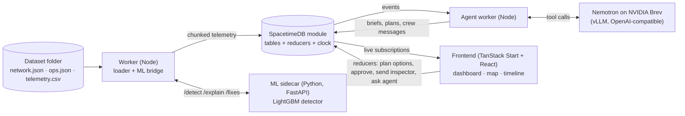
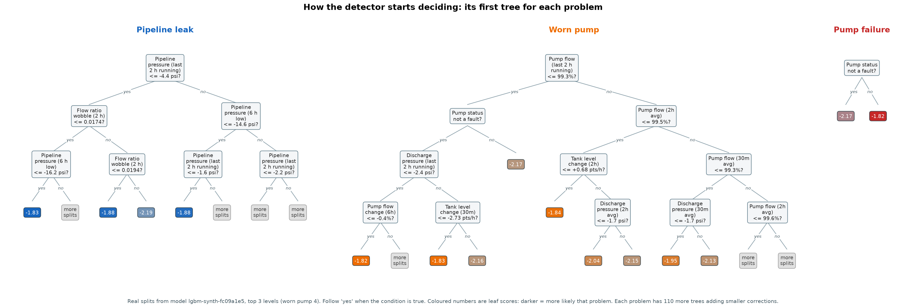

# Hivemind

**A night-shift operations console for salt water disposal networks.** Built at HackUTD: Zero Day for EOG's *Beat the Shutdown* challenge, on **SpacetimeDB**, with an **NVIDIA Nemotron** agent.

Hivemind finds pump failures, pipeline leaks and worn pumps in raw sensor data, counts down to each tank's shutdown, plans the cheapest response across a whole system of sites that share one truck fleet, and explains every decision in plain English.

| | |
|---|---|
| **Devpost** | [DEVPOST_LINK_HERE](https://devpost.com/software/hivemind-lnhy8g?ref_content=user-portfolio&ref_feature=in_progress) |
| **Demo video** | [YOUTUBE_LINK_HERE](https://www.youtube.com/watch?v=tDWAyvH1agU) |
| **Tracks** | EOG *Beat the Shutdown* · NVIDIA Nemotron *beyond a chatbot* · SpacetimeDB |

<!-- To fill in: replace DEVPOST_LINK_HERE and YOUTUBE_LINK_HERE with the full URLs, and
     YOUTUBE_VIDEO_ID with the id from the video URL (the part after "watch?v="). -->

---

## Contents

1. [The problem](#the-problem)
2. [What Hivemind does](#what-hivemind-does)
3. [Results](#results)
4. [Architecture](#architecture)
5. [How it works](#how-it-works)
   - [Data and "now"](#data-and-now)
   - [Detection: rules and machine learning](#detection-rules-and-machine-learning)
   - [Countdown to shutdown](#countdown-to-shutdown)
   - [How costs are decided](#how-costs-are-decided)
   - [The Nemotron agent](#the-nemotron-agent)
   - [Time travel and multiplayer](#time-travel-and-multiplayer)
6. [Tech stack](#tech-stack)
7. [Repository layout](#repository-layout)
8. [Run it](#run-it)
9. [Running a demo](#running-a-demo)
10. [Checks and tests](#checks-and-tests)
11. [Documentation](#documentation)
12. [Rules we hold ourselves to](#rules-we-hold-ourselves-to)
13. [Limitations and what's next](#limitations-and-whats-next)
14. [Team](#team)
15. [Acknowledgments](#acknowledgments)

---

## The problem

Every oil well produces salt water along with the oil. Each site collects that water in a tank, and a pump sends it down a pipeline to an underground disposal site. When a pump fails at 3 AM, the tank starts to fill. If it reaches its shutdown limit, the site's wells are forced off and stop producing until the repair is done.

The night-shift operator has to notice the failure, work out how long the tank can last, and choose between:

- **sending trucks** to haul water out of the tank,
- **shutting in some wells early** so the tank fills more slowly,
- a **mix** of both, or
- **letting the tank trip** and accepting the lost production.

Every site in a system shares the same two or three trucks, so a truck sent to one tank can't help another. When several pumps fail within an hour, the cheapest answer for the system is not the cheapest answer for each tank on its own. That is a lot to work out by hand, at night, while things keep going wrong.

## What Hivemind does

- **Finds problems in raw sensor data.** Pump failures, pipeline leaks and worn pumps, from telemetry alone. A LightGBM model reads trends in flow, pressure and tank level; a rules detector runs alongside it as a fallback.
- **Counts down to shutdown.** For every failed pump, the time until the tank hits its limit, with a confidence range.
- **Plans the cheapest response, system-wide.** Trucks, early well shut-ins, both, or let it trip, solved exactly for all failing tanks in a system at once, because they share the fleet.
- **Explains itself.** For every alert: why the model flagged it, and what happens next under each option, with the cost worked out step by step.
- **Has a night-shift assistant.** A Nemotron agent reviews each new failure, runs what-ifs ("what if we lose a truck?", "what if the repair takes 2 hours longer?"), drafts messages for the truck and field crews, answers operator questions and writes the shift handoff.
- **Shows the whole field.** A geographic map with honeycomb territories and trucks moving along their routes.
- **Keeps a timeline.** Each incident is linked to the decision made about it, with the cost breakdown. The backend clock can be moved to any moment in the recording, and every view then shows only what was known at that time.
- **Is multiplayer.** Every operator sees the same live state: when one person approves a plan or sends an inspector, everyone sees it at once.
- **Lets the operator act.** Compare plan options for a failure (cheapest, trucks only, shut-ins only, do nothing), approve one, pick a contingency, send an inspector to a leak or worn pump, and ask the agent questions.

## Results

Measured against the organizers' practice data (answer keys used only by the evaluation scripts, never by the app):

| Check | Result |
|---|---|
| Full scoreboard (`npm run eval`) | **170 of 170 checks pass** |
| Event detection across the full week and 3 snapshots | **87 of 87, zero false alarms** |
| Countdowns at each snapshot | **14 of 14 within ±0.1 hours** |
| Alert order | **7 of 7** |
| Plan costs | Match the reference exactly, including the hardest case: three S2 pump failures within an hour, two trucks, solved for **$3,108** |
| ML model on 8 held-out simulated weeks with unseen network shapes | **97 of 97 events, zero false alarms** |
| ML model on the real practice week (never trained on) | **23 of 23 events, zero false alarms** |
| Dress rehearsal on a network renamed S6–S10 | Live console in **2 s**, **26 of 26** events, all failures planned |
| `/detect` on one week of data | about **1 s** |

## Architecture



**SpacetimeDB is the backbone.** All state lives in one TypeScript module: datasets, the time-travel clock, telemetry, events, plans, decisions, claims, handoffs and agent traces. Detection, countdowns and plans are recomputed *inside the database* every time the clock moves. The frontend only subscribes to tables and calls reducers; it computes nothing on its own.

| Component | Folder | Role |
|---|---|---|
| SpacetimeDB module | `server/` | All state and the core loop: recompute events, countdowns and plans whenever the clock moves; validate and approve plans; multiplayer |
| Core logic | `core/` | Pure TypeScript, no Spacetime imports: tank physics, the exact planner, countdown, rules detector, ML event thresholds, plan validation, the agent's number verifier |
| Worker | `worker/` | Loads dataset folders, bridges to the ML sidecar, runs the Nemotron agent |
| ML sidecar | `ml/` | Simulator, feature pipeline, LightGBM training, FastAPI service (`/detect`, `/explain`, `/fixes`) |
| Frontend | `frontend/` | The operator console: dashboard, map and timeline, live from the database |
| Scripts | `scripts/` | Setup, data fetch, the judging flip, evaluation (the only code that reads answer keys) |

## How it works

### Data and "now"

Everything comes from the three files in a dataset folder, exactly as the organizers ship them:

| File | Contents |
|---|---|
| `network.json` | Systems, facilities, wells, tanks, pumps, pipelines, disposal sites, tank limits |
| `ops.json` | Oil and gas prices, repair time, truck capacity and price, fleet sizes, truck travel times |
| `telemetry.csv` | Every sensor reading on a 5-minute grid |

"Now" is the last timestamp in the telemetry, never the computer's clock. No asset IDs, counts or thresholds are hardcoded, so the unseen judging network loads with no code changes.

### Detection: rules and machine learning

Two detectors run side by side. The console uses the ML model when it's available and falls back to rules otherwise. A pump reporting a fault is always treated as a failure.

**The ML model** is a LightGBM classifier with four outputs: normal, pipeline leak, worn pump and pump failure.

- **Inputs:** 58 numbers per facility every 5 minutes, all relative to that facility's own specs so they work on any network. Pump flow as a share of its rated flow, the share of pumped water that reaches the disposal site, pipeline and pump outlet pressure versus normal, tank level and its trends, and how many wells are producing. Each signal is averaged over trailing windows (30 min to 24 h) using **only past data**, so time travel always shows exactly what was known at that moment (tested: identical outputs whether the data is cut at a time or not).
- **Training data:** we wrote a simulator from the challenge spec, calibrated its noise, leak and wear rates on the practice week, and generated simulated weeks with random networks and incidents. **The model never saw the organizers' data in training**; the real folders are held out for testing.
- **How it decides:** 444 small decision trees (111 rounds × 4 outputs). Each tree asks a few yes/no questions and lands on a score; the scores for each output are added up and turned into probabilities. For any single alert, SHAP values split the prediction into each input's contribution, which is the "why" the operator sees.



What the model learned for each problem:

| Problem | What pushes the model toward it |
|---|---|
| **Pipeline leak** | Pipeline pressure about 55–60 psi below normal and only about 94% of pumped water reaching the disposal site, **while the pump itself runs at full rated flow**. That last part is how it tells a leak from a worn pump. |
| **Worn pump** | Pump flow sliding to about 93–94% of rated and outlet pressure falling (about 14 psi over a day), with no pipeline pressure drop and no fault. |
| **Pump failure** | The pump reports a fault. That one signal carries about 99% of the model's importance for failures. |

The full analysis, every input, and a short rule set that imitates the model (98.9% agreement on the real week) are in [docs/MODEL_REPORT.md](docs/MODEL_REPORT.md).

**Why LightGBM:** the data is tabular with clear physical signals; trees learn thresholds and combinations ("low flow *and* not a fault") that a linear model can't; it handles missing readings natively (sensors read nothing while a pump is off); it trains in seconds on a laptop CPU; and it gives exact per-prediction explanations.

### Countdown to shutdown

For a failed pump, the tank fills at the wells' water rate:

```
level change per hour = (inflow − pump flow) ÷ 24 ÷ tank capacity × 100      (pump flow = 0 while failed)
```

The countdown starts from a noise-reduced estimate of the current level. The confidence range (p10–p90) comes from the noise in the recently observed level slope.

### How costs are decided

Every cost is one of three things, using prices and rates from the dataset files:

| Cost | Formula |
|---|---|
| **Trucks** | trucks × trips × price per trip (only trips that arrive before the repair ends) |
| **Early shut-in** | lost revenue per hour of the wells shut in × hours until the repair ends |
| **Automatic trip** | lost revenue per hour of the whole facility × hours from the trip to the repair end |

A well's lost revenue per hour is `(oil per day × oil price + gas per day × gas price) ÷ 24`.

**For each failing tank,** the planner simulates the tank minute by minute and tries every number of trucks and trips, every combination of wells to shut in (each started as *late* as possible, found exactly by binary search, because every minute a well stays on is money kept), and doing nothing.

**For each system,** an exact search over how the free trucks are split between all its failing tanks picks the lowest **total** cost. Trucks busy on an approved plan stay unavailable until they're back at the yard. Every plan is re-validated (fleet limit, trips arriving before the repair, tank volume) before it can be approved.

Example, from the challenge's opening scene (an 800-barrel tank half full, filling at 75 barrels an hour, repair in 6 hours):

| Option | Cost |
|---|---|
| **One truck, one trip.** Arrives 75 min after the call, removes 150 bbl, tank peaks at 87.5% | **$905** |
| Shut in one well from 02:25 until the repair ($500 an hour × 3.9 h) | $1,958 |
| Do nothing: the tank trips at 04:49 and all three wells stop for 1.5 h | $5,016 |

### The Nemotron agent

The agent is a worker process, not a chatbot window. When a new failure appears it starts on its own:

1. **Diagnose:** pull the event context and the system's state.
2. **Plan:** call the exact planner for the whole system.
3. **What-ifs:** re-plan with one truck fewer and with a 2-hour-longer repair, and compare.
4. **Critic:** validate the plan against the fleet, trip timing and tank limits; re-plan once if it fails.
5. **Propose:** endorse the planner's plan or propose its own, which the database validates again.
6. **Write:** an operator summary and messages for the truck and field crews.

**Every number it writes is checked** against the tool results before anyone sees it. If a number doesn't match, it rewrites; if that fails twice, a template built only from tool output is used. If the model is unreachable, the whole app keeps working on templates. The agent also answers operator questions and writes the shift handoff. Every tool call is stored as a trace in the database.

The model is **Nemotron 3 Nano 30B-A3B (FP8)**, self-hosted with vLLM on an NVIDIA L40S through NVIDIA Brev, with tool calling enabled. Running it at temperature 0.3 gave consistent, correct summaries in our tests.

### Time travel and multiplayer

Because detection, countdowns and plans are recomputed from data up to the clock, the clock can be moved anywhere in the recording (the `set_clock`, `play` and `reset_clock` reducers), and every view shows exactly what an operator would have known at that moment. Operators share one live database: approvals, inspections and handoffs appear for everyone at once. The backend also supports claiming an alert so two operators don't act on the same one (`claim_event`); the current UI doesn't expose it yet.

## Tech stack

| Layer | Technology |
|---|---|
| Database and backend logic | SpacetimeDB 2.14 (TypeScript module) |
| Core logic and worker | TypeScript, Node.js 22+, tsx, vitest |
| Machine learning | Python, LightGBM, pandas, NumPy, FastAPI, uvicorn |
| LLM | NVIDIA Nemotron 3 Nano 30B-A3B (FP8), vLLM, NVIDIA Brev (L40S) |
| Frontend | TanStack Start, React, Tailwind CSS, Vite |

## Repository layout

```
Hivemind/
├── server/              SpacetimeDB module: tables, reducers, scheduled clock
├── core/                Pure TypeScript: planner, tank simulator, countdown, rules detector, verifier
├── worker/              Dataset loader, ML bridge, Nemotron agent, CLI tools
├── ml/                  ML sidecar
│   ├── serve.py             FastAPI app: /health, /detect, /explain, /fixes, /fixes/all
│   ├── detector.py          inference and SHAP explanations
│   ├── fixes_service.py     /fixes, using the backend planner through ml/fixes/bridge.ts
│   ├── features.py          the 58 trailing-window inputs
│   ├── sim.py, gen_data.py  simulator and random week generator
│   ├── train.py             LightGBM training (synthetic data only)
│   ├── model/               trained model (lgbm.txt, meta.json)
│   ├── tests/               truncation (causality) and /fixes tests
│   └── eval/                evaluation, model report and tree images
├── frontend/            Operator console (dashboard, map, timeline)
├── scripts/             Setup, data fetch, judging flip, evaluation
├── docs/                API, contracts, model report, tree images
└── data/                Dataset folders (gitignored)
```

## Run it

### Prerequisites

- Node.js 22 or later, and Python 3.10 or later
- The SpacetimeDB CLI 2.14.x
- On Windows: Git Bash (the setup and flip scripts are bash)
- Optional: an OpenAI-compatible endpoint for Nemotron. Without one, the agent runs on templates.

### 1. Install and start the backend

```bash
curl -sSf https://install.spacetimedb.com | sh     # SpacetimeDB CLI (Windows: see below)
npm install
spacetime start                                     # local server on :3000 (separate terminal)
npm run setup                                       # publish the module, set the worker key, generate bindings
npm run data:fetch                                  # organizer datasets -> data/eog (gitignored)
npm run data:load -- --all data/eog                 # load every folder (about 1.5 s total)
npm run status                                      # what the console shows right now
```

`npm run setup` copies `.env.example` to `.env`. Secrets live only in `.env`, which is gitignored.

### 2. Start the ML sidecar and the worker

```bash
pip install -r ml/requirements.txt
npm run ml                                          # or: python ml/serve.py   (http://127.0.0.1:8001)
npm run worker                                      # sends ML results and evidence into the database
```

### 3. Start the agent (optional)

Set these in `.env`, then run `npm run agent`:

```
LLM_PROVIDER=brev                  # brev | nvidia_hosted | template
LLM_BASE_URL=https://<your-endpoint>/v1
LLM_MODEL=nvidia/NVIDIA-Nemotron-3-Nano-30B-A3B-FP8
LLM_API_KEY=<your key>
LLM_TEMPERATURE=0.3
```

Check the connection with `npm run agent -- --probe`.

### 4. Start the frontend

```bash
cd frontend
npm install
npm run dev                                         # http://127.0.0.1:8080
```

For a phone or another laptop on the same network, set `VITE_SPACETIME_URI=ws://<backend-ip>:3000` in `frontend/.env`.

### Windows notes

- Install the SpacetimeDB CLI with the official PowerShell command: `iwr https://windows.spacetimedb.com -useb | iex`, then open a new terminal.
- Run the bash-based npm scripts (`setup`, `ml`, `flip`) from Git Bash, or point npm at it once: `npm config set script-shell "C:\Program Files\Git\bin\bash.exe"`.
- `.gitattributes` keeps `ml/model/lgbm.txt` byte-for-byte: with Git's default Windows line-ending conversion, LightGBM can't read the model file.
- Use `127.0.0.1` rather than `localhost` for local services: on Windows, `localhost` adds about 2 seconds per request.

## Running a demo

**Between demos**, put the shown dataset back to its original state (about 2 s; clears approvals, what-ifs and injected failures, restarts the countdowns, and confirms the ML detector is on):

```bash
npm run data:reset                  # the dataset shown in the UI
npm run data:reset -- --all         # every dataset
npm run data:reset -- --clock-only  # only restart the countdowns
```

**The judging flip.** The organizers add a `test/` folder right before judging:

```bash
npm run flip                       # fetch test/ -> data/test, load it as dataset "test", activate, print alerts
npm run flip -- --local            # test files dropped into data/test by hand
npm run flip:drill                 # rehearsal with the mock test
```

**Live demo tools.** The backend can inject a pump failure on any site (`inject_failure`), fail every pump in a system at once, as if its disposal site shut down (`inject_system_outage`), and replay the week with different fleet sizes (`run_fleet_sweep`). The dashboard shows the resulting fleet recommendations. These are reducers rather than UI buttons; call them with the SpacetimeDB CLI, for example:

```bash
spacetime call hivemind --server local inject_failure '"mock_test_2026-10-10T1530"' '"S1_FACILITY_A"' '{"none":[]}' '{"none":[]}'
npm run data:reset                  # undo it afterwards
```

## Checks and tests

```bash
npm test                                  # unit tests + full evaluation in strict mode
npm run eval                              # one-screen scoreboard vs the answer keys
npm run eval:ml                           # the same scoring through the ML sidecar
npm run eval:synth                        # robustness on simulated weeks with unseen network shapes
npm run check:answer-key                  # confirms no app code reads answer keys
npm run export:events -- data/eog/snapshot_2026-10-10T0900   # events.json in the challenge's shape

python ml/tests/test_truncation.py        # ML outputs use no future data (largest difference 0.0)
python ml/tests/test_fixes.py             # /fixes matches the schema and the reference costs
python ml/eval/test_original.py           # ML accuracy on the organizers' weeks, event by event
python ml/eval/model_report.py            # regenerate docs/MODEL_REPORT.md
python ml/eval/plot_trees.py              # regenerate the tree images
```

## Documentation

| Document | What's in it |
|---|---|
| [docs/API.md](docs/API.md) | SpacetimeDB tables and reducers for the frontend |
| [docs/FRONTEND.md](docs/FRONTEND.md) | What the frontend shows where |
| [docs/AGENT.md](docs/AGENT.md) | The Nemotron agent: triggers, tools, verifier, configuration |
| [docs/ML_CONTRACT.md](docs/ML_CONTRACT.md) | Contract between the backend and the ML sidecar, with test results |
| [docs/API_REFERENCE.md](docs/API_REFERENCE.md) | Every ML sidecar endpoint and field, with real examples |
| [docs/API_TESTING.md](docs/API_TESTING.md) | How to test the ML sidecar by hand |
| [docs/MODEL_REPORT.md](docs/MODEL_REPORT.md) | How the detector decides: importance, real trees, a readable rule set |
| [ml/PLAN.md](ml/PLAN.md) | The ML design: simulator, training, explanations, `/fixes` |
| [STATUS.md](STATUS.md) | Progress log, results and open questions |

## Rules we hold ourselves to

- **The app never reads `answer_key.json`.** Only the evaluation scripts do, and `npm run check:answer-key` enforces it.
- **Nothing is hardcoded to one network.** IDs, counts, limits, prices and travel times all come from the files.
- **Causal everywhere.** Every output at a time uses only data up to that time, which is what makes time travel honest.
- **The ML model is trained on simulated data only.** The organizers' folders are for testing.
- **The LLM never invents numbers.** Every figure it writes is checked against tool output.

## Limitations and what's next

- **Partial plans.** The planner only considers plans that fully prevent a trip, or doing nothing. Trucks that only *delay* a trip can be cheaper in some cases.
- **Earlier warnings.** Worn pumps are caught 1–2.5 hours after they start. Training on a wider range of simulated networks should catch slow problems sooner.
- **Unpriced inspections.** The data has no price or travel time for a field inspector, so leak and worn-pump inspections show as unpriced.
- **More failure types**, and a worker that reconnects automatically if its database connection drops.

## Team

| Name | Role |
|---|---|
| Hadent Dang | Full Stack |
| Jazmin Gutierrez | Full Stack |
| Suhani Rana | Full Stack |

## Acknowledgments

- **EOG Resources** for the *Beat the Shutdown* challenge and its dataset
- **NVIDIA** for Nemotron and GPU credits on Brev
- **SpacetimeDB** (Clockwork Labs)
- **HackUTD** organizers and volunteers
